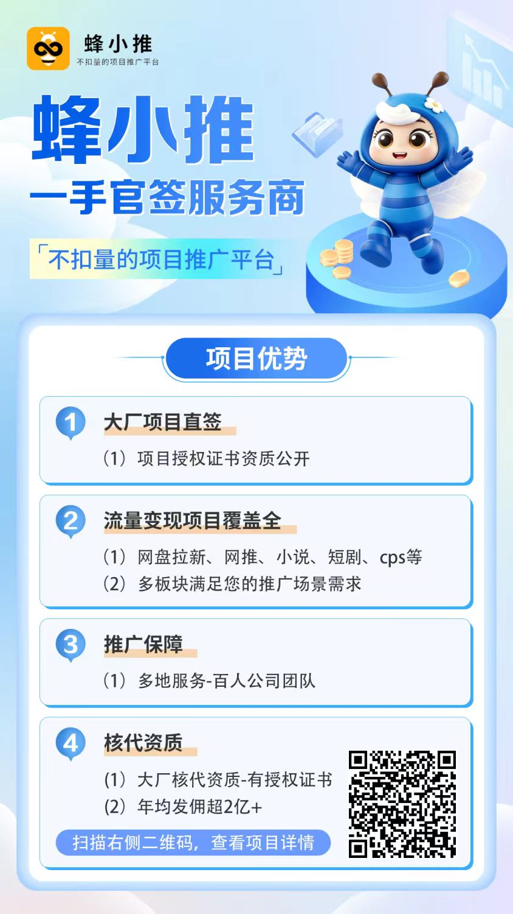

# 第一章 自媒体
本章主要介绍依靠自媒体账号本身运营得到的收入，因此没有包含知识付费（卖课、咨询）的收入。  
做自媒体建议首先确定领域（母婴、理财、美妆、装修、美食），再考虑重点经营的平台（抖音、小红书……），传播形式（视频、图文、长文）和变现渠道（平台激励、广告、带货、付费专栏）。

首先确定领域，是因为抖音、小红书等平台都鼓励博主的内容专业化，方便推荐算法来分发流量。而在此基础上，各个平台都限制用户创造的账号，如每个账号都需要绑定手机号、实名认证，因此用户能够创造的账号有限，而每个账号都被鼓励限制在单一领域内，所以建议提前决定好想主要做什么领域的内容。  
一般认为面向大众读者（尤其是女性和年长人群）的领域更容易变现，包括母婴、美妆、情感、玄学、医疗健康、国学等。  
可以选择（1）你擅长的领域（2）容易赚钱的领域（3）你感兴趣、有表达欲和分享欲的领域 这三者的交点。  
如何找到容易赚钱的领域：在（1）（3）可选的范围内，调研该领域的头部大博主，研究他们的橱窗，尤其是他们的自营商品；加他们的微信号，了解他们的广告报价（可以直接假装广告主私聊去问），观察他们的广告发布频率（能认得出来哪些是广告吧？）。

选择平台建议优先选择你自己喜欢玩的平台，其次是上一步找到的领域大博主所在的平台。在此基础上可以将内容同步发布到其它平台。

选择传播形式则要看你的创作能力和倾向，也可以都进行尝试，选择一种方向做下去。我就倾向于图文类，因为做视频很累……但是我也做视频。  
但是我不露脸。其实现在很流行的一种自媒体形式是“口播”，即直接面对屏幕发言，录制视频，可以表达作者的观点、分享一些知识。对于一些需要录屏、展示内容的场景，也可以露脸，如像老师一样做板书、或者在录屏的基础上加一个圆圈放摄像头露的脸。如果博主能接受露脸，做视频就尽量露脸，因为这样给人的“真人感”很强，能有效提高用户的付费意愿。

## 1. 各大领域当前头部博主

## 2. 自媒体平台

**通用领域**：  
推荐主要运营：
1. 抖音
2. 小红书
3. 微信视频号
4. 微信公众号

海外：
1. X
3. YouTube
2. Substack

不推荐主力运营：
1. 微博
2. 知乎
3. 哔哩哔哩
4. 闲鱼（是的，是个电商平台）
2. 百家号
3. 今日头条
7. 脉脉
6. 百度贴吧

海外：
1. LinkedIn
2. Medium

**纯技术领域**：  
1. CSDN
2. infoq
3. 博客园
4. 阿里云社区
5. 腾讯云社区

## 3. 自媒体内容形式
1. 纯文字
2. 图片+文字
2. 带排版的长文（+图）
4. 播客/视频播客
5. 视频

我写内容都是以Markdown为原始排版，另外专门做了一个微信公众号排版的内置工具；另外技术内容可以从CSDN直接同步到知乎、百家号、哔哩哔哩专栏。百家号有时排版会很难看。别的平台排版更难看了。我准备慢慢开发一键同步排版工具，往一些我认为有潜力的平台投长文。主要是之前看到的现有的工具效果都不怎么样。

### 1. 图文类平台、类型和实践经验
小红书：纯文字生图/图片+文字
微博：纯文字/图片+文字/长文（需要排版）

实测可以直接用排版好的长文截图发图片平台，效果也可以。

### 2. 视频平台、类型和实践经验
平台：抖音、小红书、微信视频号、YouTube  
（知乎和CSDN也有视频，但是谁看啊；微博视频氛围很差，全是转载视频，没有运营的价值）

1. 露脸口播/访谈：怼脸讲知识干货/有趣的内容  
我不露脸，所以不做
2. 不露脸口播  
我试过人/AI写文案，自己找些有意义的图/（剪映）找素材/（剪映）生图，AI配音 完成一个视频  
感觉AI做的东西质感还是很奇怪，虽然说自己做的也很奇怪……我再慢慢锤炼锤炼吧
2. 生活Vlog：呈现有趣生活  
我不露脸，所以不做
3. 技能教学
    1. 录屏+人工配音
    2. 纯游戏录屏

## 4. 变现渠道
### 1. 平台激励政策

### 2. 商单广告
这里指的广告是品牌指定发布内容的。下面指的是用自己的链接或者优惠码，自己想办法拉人来买的。  
一般走平台的叫“水上”，不走平台的叫“水下”。  
不走平台的一般是PR找博主私联，确定价格，不给平台抽成的钱。这种建议发布软广，因为各个平台基本都会打击硬广，会降低账号分配流量的权重。

### 3. 带货
底下“橱窗”指的是挂载到平台官方橱窗里面的商品，“推广”指的是博主自己推的、不走平台的场景。
#### 1. 橱窗
#### 2. 推广
有很多人其实专门做网盘推广，但是我是将其视为自媒体运营的一个分支来做，所以写到了自媒体这一章里面。

##### 1. 推广联盟
推广联盟我现在用过蜂小推，我的邀请链接是：  
`https://app.fengxiaotui.com/#/pages/login/reg?p=59136783`

##### 1. 网盘推广
你的网盘账户绑定推广联盟后，再将网盘链接分享给别人，别人转存后，就可以给你创造收入。如果对方是新用户，你得到的收入更高。  
可以用来分享资源，甚至结合我第五章会介绍到的虚拟产品自媒体，在卖给用户虚拟产品（如简历模板）赚到一笔钱的同时，再从推广联盟赚到一笔钱。

###### 1. 资料来源

###### 2. 各平台参考分享方案

###### 3. 实操收益

### 4. 付费专栏

### 5. 直播礼物和图文、视频打赏

## 5. 自媒体运营方法论

### 1. 运营工具
1. 生成show notes（内容提要和时间轴）

### 2. 心术
我做过高流量内容，但是很难涨粉和变现，还是挺难的……而且最近整体流量都变低了，很难啊。

不要完全依赖平台。如果能露脸，最好露脸，形成你的IP，你的经历、知识、观点、人设，是能让读者跟你走的隐形资产。

### 3. 常见规则
1. 小红书和抖音都禁止出现具体的网站链接、二维码、小众的产品名（如果是给大众程序写教程可能可以申诉通过）